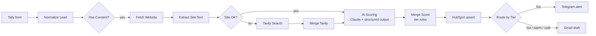

# AI Lead Qualifier (n8n)

An n8n workflow that qualifies inbound leads automatically. A prospect fills in a Tally form; the workflow researches the company, scores the lead with Claude, saves it to HubSpot, pings Telegram for hot leads and drafts a personal reply in Gmail.

## How it works



1. **Tally Trigger** receives the form submission.
2. **Normalize Lead** maps fields by question label (not by ID, so editing the form doesn't break it), lowercases the email, derives the company domain (skipping free mail providers) and checks GDPR consent.
3. **Has Consent?** stops processing if consent is missing.
4. **Fetch Website → Extract Site Text** pulls the homepage title, meta description and plain text (trimmed to 4,000 chars). Errors and timeouts don't stop the workflow.
5. **Site OK?** if the site blocked the request or returned almost nothing, **Tavily Search** looks the company up on the web instead.
6. **AI Scoring** (Claude Haiku via Basic LLM Chain + Structured Output Parser) returns a score, positive reasons, red flags, a company summary and a personal email draft.
7. **Merge Score** computes the tier in code, not by the LLM:
   - `hot` ≥ 70, `warm` ≥ 40, otherwise `cold`
   - a lead without a concrete task (`clarity_score` < 15) can never be `hot`
8. **HubSpot** upserts the contact by email (no duplicates) with custom lead properties.
9. **Route by Tier**: hot leads go to Telegram; every lead gets a Gmail **draft** to review before sending.

A separate **Error Notifier** workflow sends any failure to Telegram with the node name, message and a link to the execution. AI, HubSpot and Telegram nodes retry 3 times before failing.

## Scoring rubric

| Factor | Points |
|---|---|
| Budget | Under $1k = 5, $1k–5k = 20, $5k+ = 30 |
| Timeline | ASAP = 20, within 1 month = 15, later = 5 |
| Clarity of needs | 0–30 (concrete process = high, "automate everything" = low) |
| Company fit | 0–20 (max 10 if no company info found) |

Lead fields are treated as data, not instructions, and the model is told not to invent company facts.

## Example Telegram alert

```
🔥 HOT LEAD (84/100)
👤 John Smith — Acme Logistics
💰 $5,000+ | ⏱ ASAP (Within 2 weeks)
📝 Automate invoice processing: PDF invoices in Gmail → Google Sheets → Slack
✅ Budget in the top tier
✅ Concrete, multi-step process
⚠️ Confirm invoice volume and PDF formats
```

## Setup

### 1. Import
Import `ai-lead-qualifier.workflow.json` and `error-notifier.workflow.json` into n8n. In the Lead Qualifier: **⋯ → Settings → Error Workflow → Error Notifier**.

### 2. Tally form
Questions (labels must match exactly, or edit them in **Normalize Lead**):
- Full Name, Email Address, Company Name, Company Website (optional)
- What processes would you like to automate with AI?
- What is your approximate budget? (dropdown: `Under $1,000`, `$1,000 - $5,000`, `$5,000+`)
- What is your project timeline? (dropdown)
- GDPR & Privacy (required checkbox)

Set `YOUR_TALLY_FORM_ID` in the Tally Trigger.

### 3. HubSpot
Create a **Service Key** (Settings → Integrations → Service Keys) with `crm.objects.contacts.read`, `crm.objects.contacts.write`, `crm.schemas.contacts.read`, and add it as a **HubSpot App Token** credential.

Create these contact properties:

| Internal name | Type |
|---|---|
| `lead_score` | Number |
| `lead_tier` | Dropdown: `hot`, `warm`, `cold` |
| `lead_reasons`, `lead_red_flags`, `company_summary`, `lead_needs` | Multi-line text |
| `lead_budget`, `lead_timeline`, `lead_run_id` | Single-line text |

### 4. Other credentials
- **Anthropic** API key
- **Tavily** API key (free plan is enough to start)
- **Telegram** bot token; replace `YOUR_TELEGRAM_CHAT_ID` in both workflows (send `/start` to your bot first)
- **Gmail** OAuth2

### 5. Personalize
In **AI Scoring → System Message**, replace `[YOUR_NAME]` and adjust the rubric to your own ideal client.

## Stack
n8n (self-hosted, Docker) · Tally · Claude (Anthropic) · Tavily · HubSpot · Telegram · Gmail
