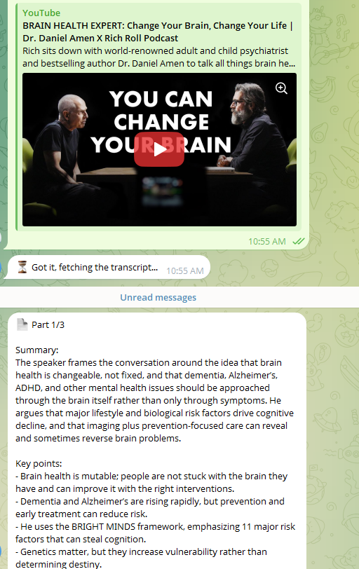

# YouTube Summary Telegram Bot

Send the bot `/yt <youtube link>` and it replies with a summary of the video: a short overview plus the key points. Long videos are split into parts, summarized one message per part, and finished with one summary of the whole video.

## Problem

Watching a 40-minute video to find out whether it's worth 40 minutes is a bad trade. Most of the time you only need the main points.

## Solution

Telegram → transcript API → Gemini (GPT as fallback) → Telegram.

1. User sends `/yt https://youtu.be/...`
2. The bot extracts the video ID (supports `watch?v=`, `youtu.be/`, `shorts/`, `live/`)
3. Fetches the transcript from [TranscriptAPI](https://transcriptapi.com), preferring Ukrainian, then English, then the original auto-generated captions
4. Splits long transcripts into parts (40k chars each, max 5)
5. Summarizes each part with **Gemini Flash** (free tier). If Gemini fails, **GPT** takes over automatically
6. Sends each part back as `📄 Part 1/3`, `📄 Part 2/3`...
7. For multi-part videos, combines the part summaries into one final `📌 Whole video summary` (same Gemini → GPT fallback)

The summary is written in the same language as the video.

## Stack

- **n8n**: orchestration
- **Telegram Bot API**: trigger and replies
- **TranscriptAPI**: YouTube transcripts
- **Google Gemini Flash**: main summarizer (free tier)
- **OpenAI**: fallback summarizer

## Edge cases handled

| Situation | What the user gets |
|---|---|
| Message from someone not on the allowlist | Nothing (ignored, no API cost) |
| Random text, sticker, photo, voice | "I didn't recognize that command" + help |
| `/yt` without a valid link | "Send me a YouTube link" + example |
| Video with no captions / API failure | "Couldn't get a transcript..." (after 1 retry) |
| Gemini overloaded or down | Summary from GPT instead, the user doesn't notice |
| Gemini and GPT both fail | "Summary failed, try again later" (sent once, not once per part) |
| Model replies with Markdown | Cleaned up before sending, so Telegram doesn't reject it |
| Very long video (3h+ podcast) | First 5 parts summarized, warning on the last message |
| Multi-part video | Part messages, then one summary of the whole video |
| Final summary fails on both models | Skipped quietly, the part summaries were already sent |
| Slow processing | "⏳ Got it, fetching the transcript..." right away |

## Design decisions

- **Gemini first, GPT as fallback.** Gemini's free tier covers personal use at no cost, but it gets overloaded at times. Routing its error output to GPT keeps the bot reliable, and OpenAI is only paid for when Gemini fails.
- **Chunking without a loop node.** The Code node returns one item per chunk, and n8n runs the model and Telegram nodes once per item. Capped at 5 parts so a 4-hour stream can't burn through credits or flood the chat.
- **Allowlist right after the trigger.** Bot usernames are public. Without it, anyone who finds the bot can spend your API credits.
- **Error reply on every path.** A bot that goes silent looks broken. Each failure point has its own message, and the summary-failed message is set to Execute Once.
- **Map-reduce for long videos.** Each part is summarized on its own (map), then the part summaries are combined in one final pass (reduce), so the overall summary connects ideas across parts. The final step runs after `Send Summary Reply`, which guarantees the parts arrive first, and only for videos with more than one part. Suggested by several people in the Reddit thread about v1.
- **One reply node for both models.** Its expression reads either Gemini's or OpenAI's response shape, so both success paths share the same formatting and Markdown cleanup.

## Setup

1. **Import** `youtube-summary-bot.workflow.json` into n8n.
2. **Credentials**: create these and select them in the matching nodes (all set to `PLACEHOLDER` in the export):
   - **Telegram API**: bot token from [@BotFather](https://t.me/BotFather). Used by the trigger and all reply nodes.
   - **Bearer Auth**: your TranscriptAPI key. Used by `Fetch Transcript`.
   - **Google Gemini (PaLM) API**: key from [Google AI Studio](https://aistudio.google.com). Used by `Summarize With Gemini` and `Final Summary (Gemini)`.
   - **OpenAI API**: used by `Fallback: Summarize With GPT` and `Final Summary (GPT)`.
3. **Allowlist**: in `Allowed User?`, replace `123456789` with your Telegram chat ID. Easiest way to find it: activate the workflow, message the bot, and read `message.chat.id` from the Telegram Trigger output in the execution log.
4. **Models**: pick a stable Flash model in the Gemini node (stable versions get overloaded less often than preview ones). The fallback uses `gpt-5.4-mini`.
5. **Optional, recommended**: in workflow settings, set an Error Workflow to get notified when a run fails, and enable Timeout Workflow (5 minutes is plenty).
6. Activate the workflow.

## Customization

- **Summary format or language**: edit the prompts in `Summarize With Gemini`, `Fallback: Summarize With GPT` and both `Final Summary` nodes. To always get, for example, Ukrainian, replace the language line with `Always write your entire reply in Ukrainian, even if the transcript is in another language.`
- **Transcript language priority**: the `language` query parameter in `Fetch Transcript` (default `uk,en,asr`). Codes are tried left to right, and `asr` means auto-generated captions in the original language. Change it to e.g. `de,en,asr` for German.
- **Chunk size / max parts**: `CHUNK_SIZE` and `MAX_CHUNKS` at the top of the `Parse Transcript Text` code node.
- **Skip the final summary**: delete the nodes after `Send Summary Reply`.
- **Faster fallback**: lower Max Tries on `Summarize With Gemini` to switch to GPT sooner.
- **Only one model**: delete the GPT node and connect Gemini's error output straight to `Summary Failed`. Or swap them, if you prefer paying for reliability.
- **More users**: change the `Allowed User?` condition to something like `{{ [111, 222].includes($json.message.chat.id) }}` (boolean "is true").
- **More commands**: add a rule to the `Route Command` switch and wire a new branch.

## Free tier notes

- Gemini's free tier has per-minute and per-day request limits. Check the current numbers in AI Studio.
- Google may use free-tier prompts to improve its products. That's usually fine for public YouTube transcripts, but don't route private data through it. With billing enabled, your data isn't used that way.
