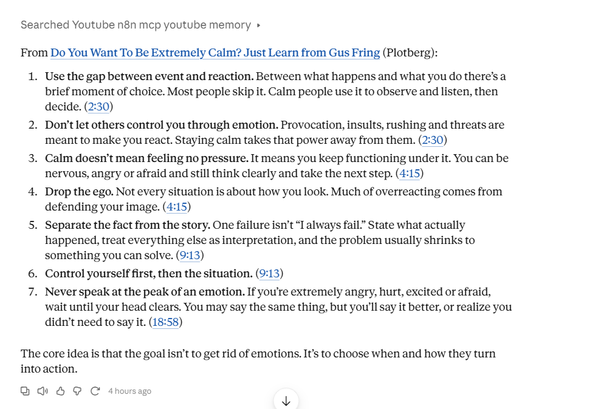
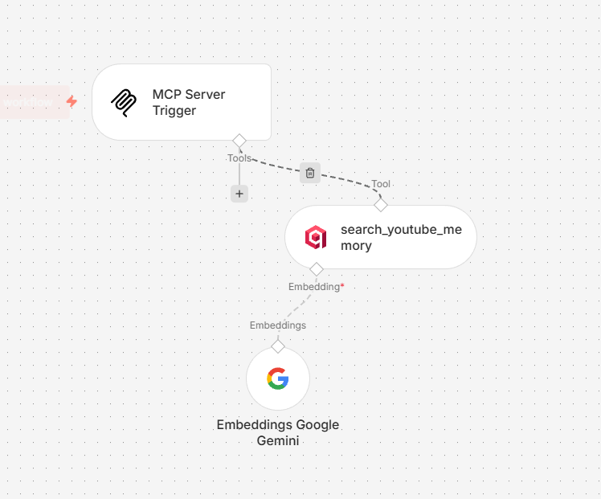
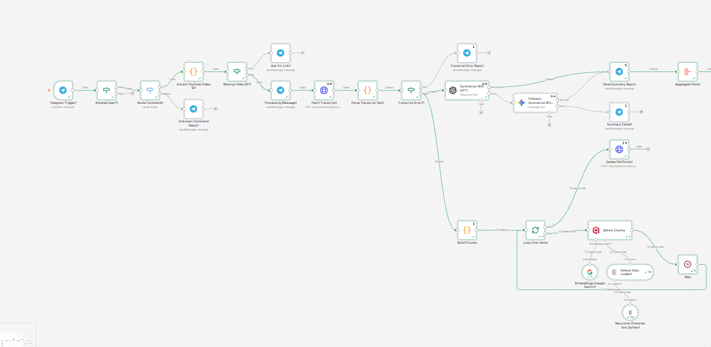
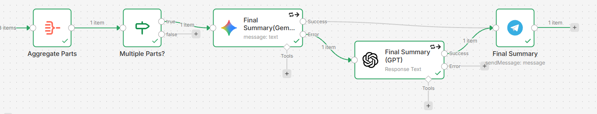

# YouTube Summary Bot + Searchable Video Memory (RAG + MCP)

Send the bot `/yt <youtube link>` in Telegram and it replies with a summary of the video. Every video is also stored in a self-hosted vector database, so later you can ask Claude questions like *"what did that video say about handling provocation?"* and get an answer with links to the exact second in the video.

| Summary in Telegram | Asking Claude about saved videos |
|---|---|
|  |  |

## Problem

Watching a 40-minute video to find out whether it's worth 40 minutes is a bad trade. And a week later, when you need that one idea from it, you can't find it again.

## Solution

Two n8n workflows:

| Workflow | What it does |
|---|---|
| `youtube-summary-bot.workflow.json` | Telegram bot: summarizes the video **and** stores its transcript in Qdrant |
| `youtube-memory-mcp.workflow.json` | MCP server: lets Claude (or any MCP client) search the stored transcripts |

```
Telegram /yt ──► Transcript ──┬──► GPT summary (Gemini fallback) ──► Telegram
                              │
                              └──► Time-based chunks ──► Gemini embeddings ──► Qdrant (self-hosted)
                                                                                  ▲
Claude ──► MCP connector (token-protected) ──► n8n MCP Server Trigger ──► search ──┘
```

### Summary flow

1. User sends `/yt https://youtu.be/...`
2. The bot extracts the video ID (supports `watch?v=`, `youtu.be/`, `shorts/`, `live/`)
3. Fetches the transcript and video metadata from [TranscriptAPI](https://transcriptapi.com), preferring Ukrainian, then English, then the original auto-generated captions
4. Splits long transcripts into parts (40k chars each, max 5)
5. Summarizes each part with **GPT**. If GPT fails, **Gemini** takes over automatically
6. Sends each part back as `📄 Part 1/3`, `📄 Part 2/3`...
7. For multi-part videos, combines the part summaries into one final `📌 Whole video summary` (Gemini first, GPT fallback)

### Memory flow (RAG)

1. **Build chunks** from the timestamped transcript lines: ~900 characters (about a minute of speech), 2 lines of overlap, and a header with the video title and channel
2. **Embed** each chunk with `gemini-embedding-001` and store it in Qdrant with metadata: `video_id`, `title`, `channel`, `url` (with `?t=` timestamp), `start`, `chunk`, `language`, `run_id`
3. **Delete old points** for this `video_id` whose `run_id` differs from the current execution, so sending a video again refreshes it instead of duplicating it

### Ask flow (MCP)

The MCP workflow exposes one tool, `search_youtube_memory`. Claude decides when to call it, gets the 5 most relevant chunks, and answers with sources that jump to the right moment.



**Bot workflow, part 1: from the Telegram message to the summaries and the memory branch**



**Bot workflow, part 2: whole-video summary and storing chunks in Qdrant**



*A real run on a video stored as 24 chunks. The memory branch runs alongside the summary branch. The screenshot shows an earlier order with Delete Old Points first; the current workflow runs Build Chunks → Qdrant → Delete Old Points.*

## Stack

- **n8n**: orchestration and MCP server
- **Telegram Bot API**: trigger and replies
- **TranscriptAPI**: YouTube transcripts with timestamps and metadata
- **OpenAI**: main summarizer
- **Google Gemini**: fallback summarizer (free tier) and embeddings (`gemini-embedding-001`)
- **Qdrant**: vector database, self-hosted next to n8n
- **Claude**: asks questions over the stored videos through MCP

## Edge cases handled

| Situation | What happens |
|---|---|
| Message from someone not on the allowlist | Ignored, no API cost |
| Random text, sticker, photo, voice | "I didn't recognize that command" + help |
| `/yt` without a valid link | "Send me a YouTube link" + example |
| Video with no captions / API failure | "Couldn't get a transcript..." (after 1 retry) |
| GPT down | Summary from Gemini instead |
| GPT and Gemini both fail | "Summary failed, try again later" (sent once, not once per part) |
| Model replies with Markdown | Cleaned up before sending, so Telegram doesn't reject it |
| Very long video (3h+ podcast) | First 5 parts summarized, warning on the last message; the full transcript is still stored |
| Multi-part video | Part messages, then one summary of the whole video |
| Same video sent twice | Old chunks deleted first, so no duplicates in search results |
| Insert fails on a re-run | Old copy of the video stays, nothing is lost |
| MCP URL leaks | Useless without the `x-api-key` token |

## Design decisions

- **Time-based chunks with a context header.** Chunks follow the transcript's own lines and keep their start time, so every search result can link to `youtu.be/ID?t=123`. The header (`Video: <title> (<channel>)`) makes each chunk self-describing, which improves retrieval and lets Claude cite the source.
- **Chunk in one place only.** Build Chunks does the chunking, and the Data Loader's splitter is set to 2000 characters so it never cuts again. With the default 1000-character splitter, chunks slightly over the limit were split right after the header line, producing title-only points that matched every query. Claude got 5 titles and no content.
- **Insert first, then delete the old copy.** Each run tags its chunks with `run_id` (the n8n execution ID). After a successful insert, a filter delete removes points with this `video_id` and a different `run_id`. If embedding or insert fails halfway (e.g. a Gemini rate limit), the delete never runs and the previous complete copy stays. An earlier delete-then-insert version could lose a video on a failed re-run. Suggested in the Reddit thread.
- **Qdrant not exposed to the internet.** It runs on the same Docker network as n8n, with no public port. The dashboard is reached through an SSH tunnel.
- **MCP protected with a header token.** Claude's custom connectors can send fixed request headers, so the MCP Server Trigger uses Header Auth (`x-api-key`) instead of relying on a secret URL alone.
- **GPT first for summaries, Gemini as fallback.** In testing, Gemini sometimes took minutes on short videos when overloaded. GPT is fast and cheap; Gemini only runs when GPT fails. The whole-video summary works on short inputs, so it tries Gemini first.
- **Map-reduce for long videos.** Each part is summarized on its own, then the part summaries are combined in one final pass. Suggested by several people in the Reddit thread about v1.
- **Allowlist right after the trigger.** Bot usernames are public. Without it, anyone who finds the bot can spend your API credits.
- **One reply node for both models.** Its expression reads either OpenAI's or Gemini's response shape, so both paths share the same formatting and Markdown cleanup.

## Setup

### 1. Qdrant (self-hosted, next to n8n in Docker)

Find your n8n container's Docker network, then start Qdrant on it without exposing a port:

```bash
QKEY=$(openssl rand -hex 32)
NET=$(docker inspect <n8n-container> --format '{{range $k,$v := .NetworkSettings.Networks}}{{$k}}{{end}}')
docker run -d --name qdrant --restart unless-stopped \
  --network "$NET" \
  -p 127.0.0.1:6333:6333 \
  -v qdrant_data:/qdrant/storage \
  -e QDRANT__SERVICE__API_KEY=$QKEY \
  qdrant/qdrant
echo "Qdrant API key: $QKEY"
```

`-p 127.0.0.1:6333:6333` is only for the dashboard over an SSH tunnel (`ssh -L 6333:127.0.0.1:6333 user@server`, then open `http://localhost:6333/dashboard`). Leave it out if you don't need the dashboard. Don't use a plain `-p 6333:6333`, which would expose Qdrant to the internet.

### 2. Bot workflow

1. **Import** `youtube-summary-bot.workflow.json`.
2. **Credentials** (all set to `PLACEHOLDER` in the export):
   - **Telegram API**: bot token from [@BotFather](https://t.me/BotFather). Used by the trigger and all reply nodes.
   - **Bearer Auth**: your TranscriptAPI key. Used by `Fetch Transcript`.
   - **OpenAI API**: used by `Summarize With GPT` and `Final Summary (GPT)`.
   - **Google Gemini (PaLM) API**: key from [Google AI Studio](https://aistudio.google.com). Used by the Gemini nodes and `Embeddings Google Gemini`.
   - **Qdrant API**: URL `http://qdrant:6333` and your Qdrant key. Used by `Qdrant Vector Store`.
   - **Header Auth**: name `api-key`, value your Qdrant key. Used by `Delete Old Points`.
3. **Allowlist**: in `Allowed User?`, replace `123456789` with your Telegram chat ID (find it in the Telegram Trigger output of any execution).
4. **Optional, recommended**: set an Error Workflow and a 5-minute Timeout in workflow settings.
5. Activate, send a video, and check the Qdrant dashboard: the `youtube_transcripts` collection is created on the first insert.

### 3. MCP workflow

1. **Import** `youtube-memory-mcp.workflow.json`.
2. **Credentials**:
   - **MCP Server Trigger → Header Auth**: name `x-api-key`, value a long random token (`openssl rand -hex 32`).
   - **Qdrant** and **Google Gemini**: the same as in the bot workflow. The embedding model **must** be the same one used when storing (`gemini-embedding-001`).
3. Activate the workflow and copy the **Production URL** from the MCP Server Trigger.
4. In Claude: **Settings → Connectors → Add custom connector**, paste the URL, choose no OAuth sign-in, and add a request header `x-api-key` with your token.
5. In a new chat, enable the connector and ask about a saved video.

Keep the MCP URL and token private. If either leaks, change the trigger's path or the token and update the connector.

**Use two separate Header Auth credentials.** The Qdrant one (`api-key` + Qdrant key) is for `Delete Old Points`, the MCP one (`x-api-key` + MCP token) is for the MCP Server Trigger. If you reuse one credential for both, one side breaks. `Delete Old Points` fails quietly because its On Error is set to Continue, and duplicates start piling up without any visible error.

## Customization

- **Summary language**: the prompts say "same language as the transcript". To always get one language, e.g. Ukrainian, use `Always write your entire reply in Ukrainian, even if the transcript is in another language.`
- **Transcript language priority**: the `language` query parameter in `Fetch Transcript` (default `uk,en,asr`). Codes are tried left to right; `asr` means auto-generated captions in the original language.
- **Chunk size / overlap**: `TARGET` and `OVERLAP_SEGS` at the top of the `Build Chunks` code node. Keep chunks under the splitter size (2000).
- **Search results**: `topK` in the MCP workflow's `search_youtube_memory` node (default 5).
- **Summary parts**: `CHUNK_SIZE` and `MAX_CHUNKS` in `Parse Transcript Text`.
- **Skip the memory branch**: delete `Build Chunks`, `Qdrant Vector Store` (with its sub-nodes) and `Delete Old Points`. The bot then works as a summarizer only.
- **More users**: change the `Allowed User?` condition to something like `{{ [111, 222].includes($json.message.chat.id) }}` (boolean "is true").

## Free tier notes

- Gemini's free tier has per-minute and per-day request limits, which also apply to embeddings. Check the current numbers in AI Studio.
- Google may use free-tier prompts to improve its products. That's usually fine for public YouTube transcripts, but don't route private data through it. With billing enabled, your data isn't used that way.
